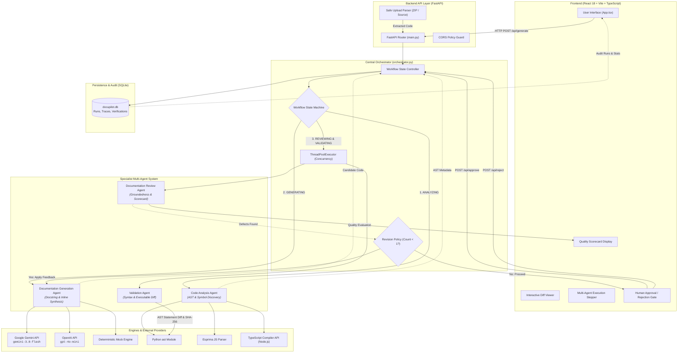

# DocuPilot AI — Project Documentation (`PROJECT.md`)

> **Comprehensive Repository Reference for AI Coding Assistants and Developers**  
> *Last Verified Implementation Date: October 2026*  
> *Target Repository Root:* `e:/Docupilot-AI-Hackathon-main/PROJECT.md`

---

## 1. Project Overview

### 1.1 Project Name
**DocuPilot AI** (Enterprise Agentic Code Documentation & Verification System)

### 1.2 Purpose & Problem Solved
Code documentation is frequently outdated, incomplete, or absent in legacy and modern software codebases. While contemporary Large Language Models (LLMs) can generate documentation, unconstrained AI code generators introduce grave risks:
1. **Code Mutation / Silent Regressions**: AI models routinely refactor, reformat, or alter executable statements, breaking production logic while inserting comments.
2. **Hallucinated Parameters & Types**: Models invent non-existent arguments, claim inaccurate types, or describe operations the function does not perform.
3. **Generic & Non-Informative Placeholders**: Models generate useless boilerplate such as `"Processes data"` or `"Executes logic"`.
4. **Lack of Truthful Verification**: Traditional tools assume AI output is valid without syntax parsing or AST statement verification.

**DocuPilot AI solves this by introducing a hybrid multi-agent architecture with a Central Orchestrator and strict human-in-the-loop governance.** The system parses code through real Abstract Syntax Tree (AST) engines, enforces truthful verification (SHA-256 AST executable fingerprinting), audits documentation groundedness, limits revisions to a single bounded cycle, and guarantees that the original source code is never altered without human review.

### 1.3 Target Users
- **Software Engineers & Code Reviewers**: Automate deep docstrings and inline comments without fear of unintended logic mutations.
- **Engineering Leads & Compliance Auditors**: Maintain explainable quality scorecards, AST verification fingerprints, and auditable history logs.
- **DevOps & Platform Teams**: Safely ingest code archives or integrate automated documentation quality gates into CI/CD pipelines.

### 1.4 Primary Technologies Used
- **Backend**: Python 3.10–3.13, FastAPI, Uvicorn, Pydantic v2, SQLite3.
- **AST & Syntax Parsers**: Python standard `ast`, JavaScript `esprima` (ECMAScript & ES6 Modules), TypeScript Compiler API (`tsc` via Node.js).
- **AI / LLM Providers**: Google Gemini API (`google-genai` SDK, `gemini-3.8-flash`), OpenAI API (`openai` SDK, `gpt-4o-mini`), and local deterministic Mock Engine.
- **Frontend**: React 18, TypeScript 5.7, Vite 6, Lucide React icons, Vanilla CSS (custom dark-mode glassmorphic design system).

---

## 2. Features

### 2.1 Multi-Agent Pipeline & Central Orchestrator
- Centralized workflow controller enforcing deterministic state machine transitions (`RECEIVED` → `ANALYZING` → `GENERATING` → `REVIEWING` / `VALIDATING` → `AWAITING_APPROVAL` → `COMPLETED` / `REJECTED` / `FAILED`).
- Thread-level concurrency: Runs the **Documentation Review Agent** and **Validation Agent** simultaneously using Python's `ThreadPoolExecutor`.
- Bounded single-revision policy: If the Review Agent detects critical omissions or generic placeholders, the generator receives actionable feedback for exactly one revision pass, preventing infinite loops.

### 2.2 AST Structural Analysis & Missing Documentation Detection
- Static symbol discovery identifying functions, asynchronous routines, classes, methods, parameters, return types, and exceptions.
- Flags symbols lacking docstrings before generation and passes structured AST metadata directly to the generation engine.

### 2.3 Multi-Language Capability Registry (14 Languages)
- Real AST and syntax validation for **Python**, **JavaScript**, and **TypeScript**.
- Heuristic regex parsing and generation for **Java**, **C**, **C++**, **C#**, **Go**, **PHP**, **Ruby**, **Swift**, **Kotlin**, **Rust**, and **SQL**.
- Transparent capability disclosure: The system explicitly marks whether a language has a real parser or syntax compiler installed, never faking verification.

### 2.4 Multi-Model AI Generation & Offline Mock Fallback
- Dual cloud LLM support: Google Gemini (`gemini-3.8-flash`) and OpenAI (`gpt-4o-mini`).
- Zero-downtime offline fallback: Automatically operates in local **Demo Mock Mode** if neither API key is configured, generating sample documentation with realistic structure without throwing startup crashes.

### 2.5 Explainable Quality Scoring Engine
- Deterministic 0–100 quality score and letter grade (`A+`, `A`, `B`, `C`, `Needs Improvement`).
- Evaluates 5 weighted static criteria against AST facts:
  1. **Parameter Coverage (35%)**: Ratio of declared parameters documented.
  2. **Return Value Coverage (25%)**: Presence and accuracy of `@return` / `Returns` sections.
  3. **Exception & Error Coverage (20%)**: Documentation of detected `raise` / `throw` statements.
  4. **Summary & Description Quality (10%)**: Descriptive header presence for core symbols.
  5. **Target Style Conformance (10%)**: Compliance with Google docstrings, NumPy, JSDoc, XML Doc, Doxygen, etc.

### 2.6 Canonical SHA-256 AST Executable Fingerprinting
- Computes a canonical SHA-256 hash over normalized executable AST statements with all comments and docstrings stripped.
- Compares original code against proposed code to mathematically prove that executable logic was not altered during documentation generation.

### 2.7 Human-in-the-Loop Approval Gate
- Proposals default to `pending_review` status.
- Users can inspect visual diffs, modify code in an embedded live editor, approve proposals, or reject proposals with a recorded audit reason.
- Original source code is strictly read-only and preserved untouched in SQLite storage.

### 2.8 Secure File & ZIP Archive Upload
- Handles single source code files and ZIP repositories up to 2MB.
- Security defenses: Prevents directory traversal (`..`), skips hidden/system directories (`node_modules`, `.git`, `__pycache__`, `.venv`), excludes credential files (`.env`, secrets, tokens, RSA keys), and prohibits binary extraction. Uploaded code is strictly analyzed statically and never executed.

### 2.9 Persistent SQLite Audit History & Metrics
- Records every run with timestamps, original code, proposed code, final approved code, analysis JSON, verification JSON, agent execution traces, and rejection reasons.
- Computes real metrics: total runs, approved, rejected, and pending.

---

## 3. Project Structure

```text
Docupilot-AI-Hackathon-main/
├── PROJECT.md                    # This master project reference document
├── README.md                     # User guide, architecture overview, and demo walkthrough
├── pytest.ini                    # Root pytest configuration
├── render.yaml                   # Cloud deployment manifest for Render (FastAPI + persistent disk)
├── docupilot.db                  # Local SQLite database (auto-generated / migrated)
│
├── backend/
│   ├── main.py                   # Entry point bridge (uvicorn runner for backend)
│   ├── requirements.txt          # Python runtime dependencies
│   ├── benchmark.py              # Reproducible test benchmark suite (latency, accuracy, cost)
│   ├── pytest.ini                # Pytest configuration inside backend directory
│   ├── .env                      # Local environment configuration (API keys, models, DB path)
│   ├── .env.example              # Sample environment template with documentation
│   │
│   ├── app/
│   │   ├── __init__.py           # Application package initializer
│   │   ├── main.py               # FastAPI application, CORS, route definitions, upload handler
│   │   ├── orchestrator.py       # Central Orchestrator, WorkflowState machine, concurrent executor
│   │   ├── analyzer.py           # AST symbol extractor, syntax validator, SHA-256 fingerprinting
│   │   ├── verifier.py           # Modular verification pipeline (syntax, style, structural AST diff)
│   │   ├── quality.py            # Deterministic quality scorecard calculation (0-100 grade)
│   │   ├── languages.py          # Central registry of 14 supported languages and capabilities
│   │   ├── store.py              # SQLite persistence, schema definition, and auto-migrations
│   │   ├── ts_runner.py          # Node.js subprocess wrapper for TypeScript compiler
│   │   ├── ts_validator.cjs      # Node.js script using typescript compiler API for AST validation
│   │   │
│   │   └── agents/               # Specialist Multi-Agent Package
│   │       ├── __init__.py       # Package exports for specialist agents
│   │       ├── code_analysis.py  # Code Analysis Agent (read-only AST parsing)
│   │       ├── documentation.py  # Documentation Generation Agent (Gemini/OpenAI/Mock)
│   │       ├── review.py         # Documentation Review Agent (groundedness & placeholder audit)
│   │       └── validation.py     # Validation Agent (syntax, style, structural fingerprint checks)
│   │
│   └── tests/
│       ├── test_analyzer.py      # 37 tests: analyzer, verifier, quality, store, API routes
│       ├── test_multi_agent.py   # 15 tests: orchestrator state machine, agent ordering, concurrency
│       └── test_upgrades.py      # 11 tests: quality scores, fingerprinting, upload security, benchmarks
│
└── frontend/
    ├── package.json              # Frontend dependencies (React 18, Vite 6, TypeScript, Lucide)
    ├── vite.config.ts            # Vite configuration
    ├── tsconfig.json             # TypeScript compiler settings
    ├── index.html                # Single Page Application HTML host
    ├── .env                      # Frontend environment config (VITE_API_URL)
    ├── .env.example              # Sample frontend environment config
    │
    └── src/
        ├── main.tsx              # React application entry point (DOM root mount)
        ├── App.tsx               # Main SPA UI: Workspace, History, Languages, Agents tabs
        └── styles.css            # Custom CSS design system, dark mode, animations, layout
```

---

## 4. Application Workflow

```text
  [User Action in Frontend]
          │ (Code input / File upload)
          ▼
   POST /api/generate
          │
          ▼
┌─────────────────────────────────────────────────────────────┐
│                 CENTRAL ORCHESTRATOR                        │
│                                                             │
│ 1. [WorkflowState: RECEIVED]                                │
│    - Validate language capability                           │
│                                                             │
│ 2. [WorkflowState: ANALYZING]                               │
│    - Dispatch to Code Analysis Agent                        │
│    - AST parsing, symbol extraction, syntax check           │
│                                                             │
│ 3. [WorkflowState: GENERATING]                              │
│    - Dispatch to Documentation Generation Agent             │
│    - Calls Gemini / OpenAI / Mock Engine                    │
│                                                             │
│ 4. [WorkflowState: REVIEWING & VALIDATING] (CONCURRENT)     │
│    ┌───────────────────────────┬──────────────────────────┐ │
│    │ Documentation Review Agent│     Validation Agent     │ │
│    │ - AST Groundedness check  │ - Syntax check           │ │
│    │ - Placeholder detection   │ - Doc style check        │ │
│    │ - Quality score (0-100)   │ - Executable AST diff    │ │
│    │ - Optional LLM audit pass │ - SHA-256 fingerprint    │ │
│    └───────────────────────────┴──────────────────────────┘ │
│                                                             │
│ 5. [Bounded Revision Gate]                                  │
│    - If Review flags defects & revision_count < 1:          │
│        Re-run Generation Agent with feedback ->             │
│        Re-run Review & Validation concurrently              │
│                                                             │
│ 6. [WorkflowState: AWAITING_APPROVAL]                       │
│    - Persist run in SQLite (status: pending_review)         │
│    - Return full payload to Frontend UI                     │
└─────────────────────────────────────────────────────────────┘
          │
          ▼
  [Human Inspection in UI]
  (Visual Diff, Quality Grade, Agent Traces, Verification)
          │
    ┌─────┴────────────────────────┐
    ▼                              ▼
Approve Patch                  Reject Patch
(POST /api/approve)            (POST /api/reject)
    │                              │
    ▼                              ▼
Final ValidationAgent Check    Store Rejection Reason
Status: approved_verified      Status: rejected
WorkflowState: COMPLETED       WorkflowState: REJECTED
```

### Complete API Endpoint Directory
| Endpoint | Method | Purpose | Input / Payload | Key Responses |
| :--- | :---: | :--- | :--- | :--- |
| `/api/generate` | `POST` | Execute full multi-agent pipeline | `{"code": str, "language": str, "doc_style": str}` | Proposed code, AST analysis, verification, scorecard, agent execution traces |
| `/api/approve` | `POST` | Human approval gate | `{"run_id": str, "code": str, "doc_style": str}` | Re-validated patch, updated status (`approved_verified`), state: `COMPLETED` |
| `/api/reject` | `POST` | Human rejection gate | `{"run_id": str, "reason": str}` | Status: `rejected`, state: `REJECTED`, original code preserved |
| `/api/history` | `GET` | List persisted runs | Query params: `limit` (default 25), `offset` | Paginated list of past audit runs |
| `/api/history/{id}`| `GET` | Retrieve single run details | Path param: `run_id` | Complete run object including original code, diffs, and agent logs |
| `/api/stats` | `GET` | Audit metrics summary | None | `total_runs`, `approved`, `rejected`, `pending` |
| `/api/upload-file`| `POST` | Upload source file or ZIP | Multipart file upload (max 2MB) | Extracted code, detected language, file tree summary |
| `/api/languages` | `GET` | Language capability registry | None | List of all 14 languages with parser types and validation flags |
| `/api/config` | `GET` | Runtime system configuration | None | Active provider, active model, demo mode flag, agent metadata |
| `/api/health` | `GET` | Health check probe | None | Database connection status (`healthy` / `degraded`) |

---

## 5. Multi-Agent Architecture

The DocuPilot AI multi-agent architecture consists of **1 Central Orchestrator** and **4 Specialist Agents**:

```text
                               ┌───────────────────────────┐
                               │   CENTRAL ORCHESTRATOR    │
                               │  (State Machine & Control)│
                               └─────────────┬─────────────┘
                                             │
             ┌───────────────────────────────┼───────────────────────────────┐
             ▼                               ▼                               ▼
   ┌───────────────────┐           ┌───────────────────┐           ┌───────────────────┐
   │   Code Analysis   │           │   Documentation   │           │   Concurrent Review│
   │       Agent       │           │ Generation Agent  │           │   & Validation    │
   │                   │           │                   │           │                   │
   │ - Python ast      │           │ - Google Gemini   │           │ ┌───────────────┐ │
   │ - JS Esprima      │           │ - OpenAI API      │           │ │ Doc Review    │ │
   │ - TS Compiler     │           │ - Mock Fallback   │           │ │ Agent         │ │
   │ - Symbol Catalog  │           │ - Revision Intake │           │ └───────┬───────┘ │
   └───────────────────┘           └───────────────────┘           │         │ (Parallel)
                                                                   │ ┌───────┴───────┐ │
                                                                   │ │ Validation    │ │
                                                                   │ │ Agent         │ │
                                                                   │ └───────────────┘ │
                                                                   └───────────────────┘
```

### Key Architectural Tenets
1. **Separation of Concerns**: Static analysis and syntax validation are strictly deterministic and isolated from stochastic LLM generation.
2. **Deterministic Orchestration**: The orchestrator controls all sequencing and state transitions; individual agents cannot arbitrarily invoke one another or loop indefinitely.
3. **Bounded Iteration**: Review feedback triggers at most **one** revision cycle.
4. **Human Final Authority**: No code is merged or updated in the repository automatically.

---

## 6. Agent Responsibilities

### 6.1 Central Orchestrator (`Orchestrator`)
- **Location**: `backend/app/orchestrator.py`
- **Purpose**: Controls the multi-agent pipeline, enforces valid state transitions, initiates concurrent review/validation, evaluates the bounded revision rule, and gates approval/rejection.
- **Logic Type**: Conventional Python logic (Deterministic finite state machine + `ThreadPoolExecutor`).

### 6.2 Agent 1: Code Analysis Agent (`CodeAnalysisAgent`)
- **Location**: `backend/app/agents/code_analysis.py`
- **Purpose**: Performs read-only structural parsing, symbol discovery, syntax verification, and missing documentation detection.
- **Inputs**: `code: str`, `language: str`
- **Outputs**: `CodeAnalysisResult` (Pydantic model):
  - `status`: `"completed"` or `"failed"`
  - `valid_syntax`: `bool` or `None`
  - `syntax_status`: `"verified"`, `"invalid"`, `"unsupported_language"`, or `"heuristic"`
  - `parser_used`: `"python_ast"`, `"esprima"`, `"typescript_compiler"`, or `"regex_heuristic"`
  - `symbol_count`: `int`
  - `symbols`: `list[dict]` (classes, functions, parameters, return types, exceptions)
  - `missing_docs`: `list[dict]` (symbols lacking docstrings)
  - `evidence`: Parsed syntax diagnostics, capabilities, and fingerprint
  - `execution_time_ms`: Execution latency
- **Tools / APIs**: Python `ast` module, `esprima` parser, Node.js `ts_validator.cjs` runner, and `backend/app/languages.py`.
- **Decision Logic**: Validates language support. If supported, runs the appropriate parser. If syntax fails on verified languages, flags errors. Catalogs all symbols and computes missing docstrings.
- **LLM vs Python Logic**: **Conventional Python logic only.** Using an LLM for AST parsing would introduce hallucinations into structural ground-truth.

### 6.3 Agent 2: Documentation Generation Agent (`DocumentationGenerationAgent`)
- **Location**: `backend/app/agents/documentation.py`
- **Purpose**: Generates high-quality docstrings, type annotations, and inline comments based on structural AST findings, target documentation styles, and review feedback.
- **Inputs**:
  - `code: str`: Original source code
  - `language: str`: Programming language
  - `analysis: dict`: Structural AST evidence from Code Analysis Agent
  - `doc_style: str`: Target format (`google`, `numpy`, `jsdoc`, `doxygen`, etc.)
  - `revision_feedback: Optional[str]`: Actionable directives from Review Agent (if on revision #1)
  - `revision_number: int`: `0` for initial generation, `1` for revision
- **Outputs**: `DocumentationResult` (Pydantic model):
  - `status`: `"completed"` or `"failed"`
  - `proposed_code`: Full updated source code with comments inserted
  - `mode`: `"gemini"`, `"openai"`, or `"demo_mock"`
  - `model`: Model identifier (e.g. `gemini-3.8-flash`, `gpt-4o-mini`, `mock-engine`)
  - `doc_style`: Target documentation style
  - `revision_number`: Revision index
  - `summary`: Human-readable generation summary
  - `execution_time_ms`: Execution latency
- **Tools / APIs**: Google Gemini API (`google-genai` SDK), OpenAI API (`openai` SDK), or deterministic `mock_documentation` engine.
- **Decision Logic**: Inspects available environment keys. Selects the active provider. Constructs a prompt embedding AST hints and revision directives. Invokes the model with a low temperature (`0.2`), strips markdown fences, and returns clean code.
- **LLM vs Python Logic**: **Hybrid (LLM with Python Mock Fallback).** Generative LLMs synthesize natural-language explanations, while Python handles prompt assembly, fence stripping, and mock fallback.

### 6.4 Agent 3: Documentation Review Agent (`DocumentationReviewAgent`)
- **Location**: `backend/app/agents/review.py`
- **Purpose**: Audits the proposed documentation against the original source code and AST evidence. Checks parameter grounding, detects generic placeholders, and computes the quality score.
- **Inputs**:
  - `original_code: str`: Original baseline code
  - `proposed_code: str`: Candidate documented code
  - `language: str`: Target language
  - `analysis: dict`: Baseline AST analysis
  - `doc_style: str`: Target documentation style
- **Outputs**: `ReviewResult` (Pydantic model):
  - `status`: `"passed"` or `"needs_revision"`
  - `score`: `int` (0–100)
  - `grade`: Letter grade (`A+`, `A`, `B`, `C`, `Needs Improvement`)
  - `severity`: `"none"`, `"low"`, `"medium"`, or `"high"`
  - `quality_score`: Detailed 5-criteria scorecard breakdown
  - `findings`: List of human-readable findings
  - `hallucinations`: Inaccuracies detected
  - `actionable_feedback`: Specific instructions for the generator if revision is required
  - `review_type`: `"deterministic_static"` or `"independent_llm"`
  - `execution_time_ms`: Execution latency
- **Tools / APIs**: `backend/app/quality.py`, regex pattern matcher for generic placeholders (`describe what`, `processes data`, `insert description`, etc.), and optional independent auditor LLM pass (`_review_with_llm`).
- **Decision Logic**:
  - Checks if declared parameters in the original code are missing from docstrings.
  - Scans for banned placeholder phrases.
  - If severity is `"high"` or score is below 50, sets `status = "needs_revision"` and composes `actionable_feedback`.
  - Otherwise, marks status as `"passed"`.
- **LLM vs Python Logic**: **Hybrid.** Primary scoring and parameter grounding are 100% deterministic Python. If cloud LLM keys are configured, an advisory secondary audit pass runs via Gemini or OpenAI to catch subtle semantic inconsistencies.

### 6.5 Agent 4: Validation Agent (`ValidationAgent`)
- **Location**: `backend/app/agents/validation.py`
- **Purpose**: Enforces deterministic syntax verification, documentation style checks, and AST executable statement preservation.
- **Inputs**:
  - `proposed_code: str`: Candidate code to validate
  - `language: str`: Target language
  - `original_code: Optional[str]`: Original code baseline
  - `doc_style: str`: Documentation style standard
- **Outputs**: `ValidationResult` (Pydantic model):
  - `status`: `"verified"`, `"partially_verified"`, or `"failed"`
  - `passed`: `bool` (True if syntax and structural consistency passed)
  - `global_status`: `"verified"`, `"partially_verified"`, or `"failed"`
  - `checks`: List of 4 modular verification check results:
    1. Syntax & Parser Validity
    2. Documentation Style & Format
    3. Structural Consistency (AST executable statement diff)
    4. Behavioral Regression Tests (reported honestly as `not_run`)
  - `errors`: Diagnostic error list
  - `fingerprint`: Canonical SHA-256 AST executable fingerprint
  - `execution_time_ms`: Execution latency
- **Tools / APIs**: `backend/app/verifier.py`, `backend/app/analyzer.py` (`compute_executable_fingerprint`), `ts_runner.py`.
- **Decision Logic**:
  - Validates syntax using the language's real parser.
  - Strips docstrings/comments from both original and proposed code and compares executable AST dumps (Python) or non-comment token streams (other languages).
  - If any executable statement, variable name, or operator was changed, the check immediately fails.
- **LLM vs Python Logic**: **Conventional Python logic only.** Validation must be an unyielding, deterministic gate; LLMs are never used to validate syntax or logic preservation.

---

## 7. Orchestrator Workflow

### 7.1 State Machine Specification
The Orchestrator maintains and validates strict transitions across 9 workflow states:

| From State | Allowed Transitions | Trigger / Condition |
| :--- | :--- | :--- |
| `RECEIVED` | `ANALYZING`, `FAILED` | Request received and language capability confirmed |
| `ANALYZING` | `GENERATING`, `FAILED` | Code Analysis Agent completes AST symbol discovery |
| `GENERATING` | `REVIEWING`, `VALIDATING`, `FAILED` | Candidate code produced by Documentation Generation Agent |
| `REVIEWING` / `VALIDATING` | `GENERATING` | Review Agent flags `needs_revision` and `revision_count < 1` |
| `REVIEWING` / `VALIDATING` | `AWAITING_APPROVAL` | Review passed OR maximum revision bound (1) reached |
| `AWAITING_APPROVAL` | `COMPLETED` | User approves proposal via `/api/approve` |
| `AWAITING_APPROVAL` | `REJECTED` | User rejects proposal via `/api/reject` |
| `COMPLETED` / `REJECTED` / `FAILED` | *(Terminal)* | Workflow reached final auditable state |

### 7.2 Data Passing Between Agents
1. **User Request** (`code`, `language`, `doc_style`) → passed to `code_analysis_agent.run()`.
2. **Analysis Output** (`analysis_res.analysis` containing symbols, parameters, and AST hints) → passed along with `code` to `doc_generation_agent.run()`.
3. **Generated Candidate Code** → passed concurrently to:
   - `doc_review_agent.run(original_code, candidate_code, language, analysis, doc_style)`
   - `validation_agent.run(candidate_code, language, original_code, doc_style)`
4. **Review Feedback (if revision required)**:
   - `doc_generation_agent.run(..., revision_feedback=review_res.actionable_feedback, revision_number=1)`
   - Revised code undergoes a second concurrent Review and Validation pass.
5. **Final Package**: Stored in SQLite and returned to frontend with full agent telemetry.

### 7.3 Error Handling & Fallback Behavior
- **Invalid Language (400)**: Orchestrator sets state to `FAILED` and raises HTTP 400 with supported language list.
- **Fatal Parse Error on Source (422)**: Raises HTTP 422 with parser diagnostic details.
- **Generator Failure (502)**: If candidate code is empty or cloud API errors out, raises HTTP 502 without modifying database state.
- **Cloud API Spikes (503 / 429)**: The system bubbles up upstream provider errors explicitly rather than silently switching to mock mode when live keys are configured, preventing deceptive audit records.

---

## 8. Architecture Diagram



---

## 9. Technology Stack

### 9.1 Backend
- **Python**: 3.10–3.13 supported (tested on Python 3.13.5).
- **FastAPI** (`>=0.115,<1`): Async web framework with automated OpenAPI documentation.
- **Uvicorn** (`>=0.30,<1`): ASGI production server.
- **Pydantic** (`v2`): Strongly typed schemas for requests, responses, and agent execution models.
- **google-genai** (`>=1.0.0`): Official Google GenAI SDK for Gemini models.
- **openai** (`>=1.60,<3`): Official OpenAI client SDK.
- **python-dotenv** (`>=1,<2`): Environment variable loader.
- **esprima** (`>=4.0.1`): ECMAScript AST parsing for JavaScript.
- **python-multipart** (`>=0.0.9`): Safe multipart upload processing.
- **pytest** (`>=8,<9`): Backend automated testing framework.
- **SQLite3**: Standard library persistent transactional database.

### 9.2 Frontend
- **React** (`^18.3.1`): Declarative component UI.
- **TypeScript** (`^5.7.2`): Strict frontend type safety.
- **Vite** (`^6.4.0`): Modern build tool and development server.
- **Lucide React** (`^0.468.0`): High-clarity iconography.
- **Vanilla CSS**: Bespoke glassmorphic design system (`styles.css`), responsive grid layout, zero heavyweight CSS frameworks.

### 9.3 External Runtimes
- **Node.js**: Required locally for TypeScript AST compiler validation via `backend/app/ts_validator.cjs`.

---

## 10. Environment Configuration

All environment variables must be declared in environment files (`.env`). **Never commit actual API keys, secrets, or tokens.**

### 10.1 Backend Configuration (`backend/.env`)
| Variable Name | Default Value | Required? | Purpose |
| :--- | :--- | :---: | :--- |
| `GEMINI_API_KEY` | *(empty)* | Optional* | Google AI Studio Gemini API key. *(Recommended free tier)* |
| `GEMINI_MODEL` | `gemini-3.8-flash` | Optional | Google Gemini model identifier. |
| `OPENAI_API_KEY` | *(empty)* | Optional* | OpenAI API key for GPT models. |
| `OPENAI_MODEL` | `gpt-4o-mini` | Optional | OpenAI model identifier. |
| `LLM_PROVIDER` | *(empty / auto)* | Optional | Explicit provider override (`gemini` or `openai`). Defaults to auto-detect based on configured key. |
| `FRONTEND_ORIGIN` | `http://localhost:5173` | Optional | Allowed CORS origin for frontend client. |
| `DATABASE_PATH` | `./docupilot.db` | Optional | Path to local or persistent volume SQLite database file. |

*\*Note: If neither `GEMINI_API_KEY` nor `OPENAI_API_KEY` is provided, DocuPilot AI automatically runs in local **Demo Mock Mode**.*

### 10.2 Frontend Configuration (`frontend/.env`)
| Variable Name | Default Value | Required? | Purpose |
| :--- | :--- | :---: | :--- |
| `VITE_API_URL` | `http://localhost:8000` | Optional | Base URL of the backend FastAPI service. |

---

## 11. Installation and Setup

### 11.1 Prerequisites
- **Python**: Version 3.10 or higher.
- **Node.js**: Version 18 or higher (with `npm`).
- **Git**: For version control.

### 11.2 Step-by-Step Setup Instructions

#### Step 1: Clone Repository
```bash
git clone <repository-url>
cd Docupilot-AI-Hackathon-main
```

#### Step 2: Configure Backend Environment
```bash
cd backend
cp .env.example .env
# Edit backend/.env and optionally paste your GEMINI_API_KEY or OPENAI_API_KEY
```

#### Step 3: Install Backend Dependencies
On Windows (PowerShell):
```powershell
python -m venv .venv
.\.venv\Scripts\Activate.ps1
python -m pip install --upgrade pip
pip install -r requirements.txt
```

On macOS / Linux:
```bash
python3 -m venv .venv
source .venv/bin/activate
pip install --upgrade pip
pip install -r requirements.txt
```

#### Step 4: Configure Frontend Environment
```bash
cd ../frontend
cp .env.example .env
npm install
```

---

## 12. Commands to Run the Project

### 12.1 Start Backend Server
From the `backend` directory (with virtual environment activated):
```bash
# Recommended command:
uvicorn app.main:app --host 127.0.0.1 --port 8000 --reload

# Alternatively, run via entrypoint bridge:
python main.py
```
*Backend Swagger Docs will be accessible at: `http://localhost:8000/docs`*

### 12.2 Start Frontend Client
From the `frontend` directory:
```bash
npm run dev
```
*Frontend Application will be accessible at: `http://localhost:5173`*

### 12.3 Build Frontend for Production
```bash
npm run build
# To preview the built distribution:
npm run preview
```

### 12.4 Run Reproducible Benchmark Suite
From the `backend` directory:
```bash
python benchmark.py
```

---

## 13. Testing and Troubleshooting

### 13.1 Running Automated Tests
The repository features 63 comprehensive unit and integration tests across three test suites:

```bash
# From backend directory:
python -m pytest -v

# Run multi-agent architecture tests specifically:
python -m pytest tests/test_multi_agent.py -v

# Run static analysis and capability tests:
python -m pytest tests/test_analyzer.py -v

# Run upgrade and security tests:
python -m pytest tests/test_upgrades.py -v
```

### 13.2 Testing Offline / In Mock Mode
To run pytest offline without invoking real cloud LLMs or consuming API quotas:
```powershell
# PowerShell:
$env:GEMINI_API_KEY=""; $env:OPENAI_API_KEY=""; python -m pytest -v
```
```bash
# Bash:
GEMINI_API_KEY="" OPENAI_API_KEY="" python -m pytest -v
```

### 13.3 Common Troubleshooting Scenarios

| Issue | Cause | Solution |
| :--- | :--- | :--- |
| **HTTP 502 / 503 from Gemini** | Google AI Studio model experiencing temporary demand spikes. | Wait 30 seconds and retry, or temporarily remove `GEMINI_API_KEY` to run in zero-failure Demo Mock Mode. |
| **TypeScript Parser Unavailable** | Node.js or `typescript` module missing in the system path. | Ensure Node.js is installed on your machine. The system gracefully reports `"partially_verified"` rather than crashing. |
| **CORS Network Error in Frontend** | Backend `FRONTEND_ORIGIN` does not match the frontend port (e.g. port 5174 instead of 5173). | Update `FRONTEND_ORIGIN` in `backend/.env` or rely on the automatic fallback origins (`5173`, `5174`, `127.0.0.1:5173`). |
| **Port 8000 or 5173 Already in Use** | Another process is occupying the default port. | Specify custom ports: `uvicorn app.main:app --port 8001` and update `VITE_API_URL` in `frontend/.env`. |
| **SQLite Database Locked** | Multiple write transactions accessing `docupilot.db` concurrently. | The connection pool in `backend/app/store.py` utilizes a 10-second timeout; ensure background processes release connections. |

---

## 14. Current Implementation Status

### 14.1 Completed Features
- Full 4-Specialist-Agent system orchestrated by a centralized state machine.
- Real AST parsing for Python (`ast`), JavaScript (`esprima`), and TypeScript compiler API.
- True SHA-256 executable AST statement fingerprinting.
- Concurrent ThreadPool execution of Review Agent and Validation Agent.
- Bounded 1-revision policy addressing actionable Review feedback.
- Deterministic 5-criteria quality scorecard (0–100 score + letter grade).
- Safe file and ZIP archive extraction with path traversal guards.
- Interactive React UI with visual diffs, stepper trace, live editor, and human approval gate.
- SQLite audit persistence with backward-compatible schema auto-migration.
- 63 passing automated tests covering all critical paths.

### 14.2 Partially Implemented / Environmental Fallbacks
- **11 Secondary Languages** (`java`, `c`, `cpp`, `csharp`, `go`, `php`, `ruby`, `swift`, `kotlin`, `rust`, `sql`): Extracted via robust regex heuristics. The system reports `"partially_verified"` truthfully because full native compilers for all 11 languages are not bundled in the local Python environment.
- **Behavioral Regression Tests**: The framework includes Check #4 in `verifier.py`, but deliberately returns `"not_run"` because arbitrary sandbox execution is prohibited without isolated containerization.

### 14.3 Known Limitations
- **Maximum 1 Revision**: Revisions are strictly capped at 1 to prevent runaway LLM costs and infinite review loops.
- **No In-Place Repository Mutating**: Code is never written directly to the host filesystem; human approval via the UI or API is always required.

### 14.4 Proposed / Future Work
- Containerized sandbox runner (e.g., Docker / WebAssembly) for executing behavioral regression tests safely.
- Real-time WebSocket or Server-Sent Events (SSE) streaming for token-by-token documentation generation and live agent transitions.

---

## 15. Developer Guidelines

### 15.1 Adding a New Feature
1. **Preserve Existing API Contracts**: Existing endpoints (`/api/generate`, `/api/approve`, `/api/reject`, etc.) must remain backward-compatible.
2. **Never Execute User Code**: All analyzers and validators must remain static. Do not use `eval()` or `exec()`.

### 15.2 Modifying Existing Agents
- Agent implementations reside in `backend/app/agents/`.
- Each agent must return a strongly typed Pydantic result model (`CodeAnalysisResult`, `DocumentationResult`, `ReviewResult`, `ValidationResult`).
- Ensure all agent result models include `agent_name`, `status`, `summary`, `execution_time_ms`, and `evidence`.

### 15.3 Registering a New Agent with the Orchestrator
1. Create the agent class in `backend/app/agents/<agent_name>.py`.
2. Export the agent from `backend/app/agents/__init__.py`.
3. Instantiate the agent in `Orchestrator.__init__()` in `backend/app/orchestrator.py`.
4. Define any new state in `WorkflowState(str, Enum)` and update `VALID_TRANSITIONS`.
5. Incorporate the agent execution into `Orchestrator.process_code_generation()` and append its output to `agent_executions`.
6. Add corresponding unit tests in `backend/tests/test_multi_agent.py`.

### 15.4 Frontend Extension Guidelines
- When adding views or tabs to `frontend/src/App.tsx`, maintain the existing navigation model (`workspace`, `history`, `languages`, `agents`).
- Use icons from `lucide-react`.
- Define all styles in `frontend/src/styles.css` using the existing CSS variables (`--bg-primary`, `--accent-primary`, `--border-color`, etc.) to preserve design consistency.
