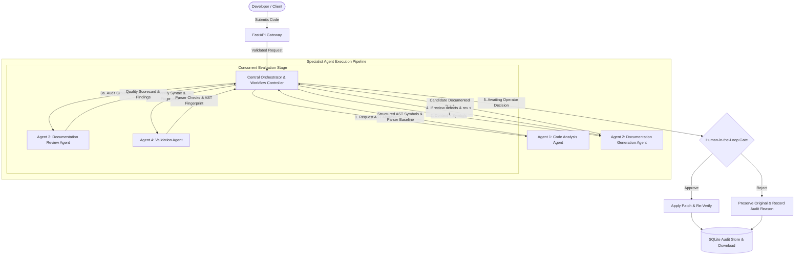

# DocuPilot AI: Multi-Agent Architecture

> **Agentic, context-aware code documentation system governed by a Central Orchestrator and four specialist agents with concurrent review & validation, bounded revisions, strict AST consistency verification, explicit human approval, and SQLite persistence.**

Built for the **Ziro Agentic AI Hackathon 2026**.

---

## 1. System Architecture

DocuPilot AI employs a **Hybrid Multi-Agent Architecture** coordinated by a deterministic **Central Orchestrator**. The system separates responsibilities across four specialized agents, guaranteeing code safety, truthful parser feedback, grounded documentation review, and zero uncontrolled code mutations.



---

## 2. The Central Orchestrator & Specialist Agents

### Central Orchestrator (`backend/app/orchestrator.py`)
- **Role**: Central workflow controller and state machine manager.
- **Workflow State Machine**:
  ```text
  RECEIVED ➔ ANALYZING ➔ GENERATING ➔ REVIEWING & VALIDATING ➔ AWAITING_APPROVAL ➔ COMPLETED | REJECTED | FAILED
  ```
- **Concurrency**: Executes the **Documentation Review Agent** and **Validation Agent** concurrently via `ThreadPoolExecutor` over the immutable candidate patch.
- **Bounded Revision Loop**: If the Review Agent identifies missing parameters, unsupported claims, or low coverage, the Orchestrator requests **at most one** revision pass from the Generation Agent with actionable feedback. This eliminates infinite loops and prevents API cost runaway.
- **Validation Gating**: If syntax or structural statements fail validation, the candidate cannot complete successfully or bypass the approval policy.
- **Human Gate**: Never auto-merges or auto-applies code. Strict operator inspection of the diff is mandatory before applying patches.

---

### Agent 1: Code Analysis Agent (`backend/app/agents/code_analysis.py`)
- **Responsibility**: Language detection, AST and structural parsing, symbol extraction, missing doc identification.
- **Reused Modules**: `analyzer.py`, `languages.py`.
- **Parser Engines**:
  - **Python**: Native Python AST parser (`ast`).
  - **JavaScript**: ECMAScript and ES Module AST parser (`esprima`).
  - **TypeScript**: TypeScript compiler AST parser and syntax diagnostics (`ts_runner.py` / `ts_validator.cjs`).
  - **Other 11 Languages**: Heuristic symbol extraction, honestly labelled as `syntax_status: not_verified`.
- **Safety**: Pure read-only operation; original code is never modified.

---

### Agent 2: Documentation Generation Agent (`backend/app/agents/documentation.py`)
- **Responsibility**: Context-aware synthesis of explanatory docstrings and inline comments grounded in the Code Analysis Agent's findings.
- **Reused Modules**: OpenAI (`gpt-4o-mini`), Google Gemini (`gemini-3.8-flash`), and local deterministic mock engine.
- **Conventions Supported**:
  - Python: Google PEP 257 standard (`Args:`, `Returns:`, `Raises:`) or NumPy standard (`Parameters`, `Returns`, `Raises` with underlines).
  - JavaScript / TypeScript: JSDoc / TSDoc (`@param {type}`, `@returns {type}`).
  - Java: Javadoc (`@param`, `@return`, `@throws`).
  - C#: XML Documentation (`/// <summary>`, `/// <param>`).
  - C / C++: Doxygen style (`@brief`, `@param`, `@return`).
  - Go, PHP, Ruby, Swift, Kotlin, Rust, SQL: Idiomatic conventions.
- **Revision Support**: Incorporates review feedback directives if a revision is requested by the Orchestrator.
- **Safety**: Emits an isolated proposed candidate patch; never overwrites original source code directly.

---

### Agent 3: Documentation Review Agent (`backend/app/agents/review.py`)
- **Responsibility**: Independent evaluation of documentation quality and semantic groundedness against original source code.
- **Reused Modules**: `quality.py`, `analyzer.py`.
- **Review Criteria**:
  1. **Parameter Groundedness (35%)**: Audits whether declared parameters are documented; detects hallucinated parameters in docstrings that do not exist in signatures.
  2. **Return Groundedness (20%)**: Audits whether functions returning values document return types, and flags return claims for void/non-returning functions.
  3. **Exception / Error Groundedness (15%)**: Audits whether declared or raised exceptions are documented.
  4. **Summary Quality (15%)**: Detects and rejects generic placeholder phrases (`"Processes data"`, `"Executes logic"`, `"Describe x"`, `"TODO"`).
  5. **Style Conformance (15%)**: Checks conformance to target style rules.
- **Output**: Returns an explainable quality score (0–100), letter grade (A+, A, B, C, Needs Improvement), specific findings, and actionable feedback for the bounded revision loop.

---

### Agent 4: Validation Agent (`backend/app/agents/validation.py`)
- **Responsibility**: Deterministic static validation of the candidate updated code.
- **Reused Modules**: `verifier.py`, `ts_runner.py`, `ts_validator.cjs`.
- **Validation Pipeline**:
  1. **Syntax & Parser Validity**: Real parser/compiler execution (Python AST, Esprima, TypeScript compiler API).
  2. **Documentation Style**: PEP 257 format, JSDoc/TSDoc tags, and language style rules.
  3. **Structural Consistency (AST Fingerprint)**: Computes canonical SHA-256 fingerprint over non-comment executable statements. Guarantees 100% preservation of original executable code.
  4. **Behavioral Regression Check**: Explicitly and truthfully reported as `not_run` without an isolated test harness.
- **Honesty Disclosure**: Clearly distinguishes static syntax parsing and AST fingerprinting from dynamic runtime semantic equivalence.

---

## 3. Workflow State Machine

```text
[RECEIVED] 
    │ (Validate language & assign run_id)
    ▼
[ANALYZING] (Code Analysis Agent)
    │ (Extract AST symbols & parser baseline)
    ▼
[GENERATING] (Documentation Generation Agent)
    │ (Generate candidate patch)
    ▼
[REVIEWING & VALIDATING] (Concurrent execution)
    ├───────────────┬───────────────┐
    ▼               ▼               ▼
Review Agent   Validation Agent  (Both operate concurrently on candidate)
    └───────────────┴───────────────┘
                    │
            Orchestrator Evaluates
                    │
        ┌───────────┴───────────┐
        ▼                       ▼
  Review Defect?          Checks Pass?
 (rev_count < 1)                │
        │                       ▼
        │ (1 Revision)   [AWAITING_APPROVAL] (Operator reviews Diff)
        ▼                       │
  [GENERATING]                  ├───────────────┬───────────────┐
  (with feedback)               ▼               ▼               ▼
                               Approve        Reject         Timeout/Cancel
                                │               │               │
                                ▼               ▼               ▼
                           [COMPLETED]     [REJECTED]        [FAILED]
                          (Re-verified)  (Original kept)
```

---

## 4. Language Capability Matrix

| Language | Identifier | Extension | Parser Engine | Syntax Validation | Documentation Convention |
| :--- | :--- | :--- | :--- | :--- | :--- |
| **Python** | `python` | `.py` | Python AST | **Full AST Verified** | PEP 257 / Google (`"""`) / NumPy |
| **JavaScript** | `javascript` | `.js` | Esprima | **Full AST Verified** | JSDoc (`/** ... */`) |
| **TypeScript** | `typescript` | `.ts` | TS Compiler API | **Full AST Verified** | TSDoc / JSDoc (`/** ... */`) |
| **Java** | `java` | `.java` | Regex Structural | *Not Verified (No Local Parser)* | Javadoc (`/** ... */`) |
| **C** | `c` | `.c` | Regex Structural | *Not Verified (No Local Parser)* | Doxygen (`/** ... */`) |
| **C++** | `cpp` | `.cpp` | Regex Structural | *Not Verified (No Local Parser)* | Doxygen (`/** ... */`) |
| **C#** | `csharp` | `.cs` | Regex Structural | *Not Verified (No Local Parser)* | XML Comments (`/// <summary>`) |
| **Go** | `go` | `.go` | Regex Structural | *Not Verified (No Local Parser)* | Go doc (`// ...`) |
| **PHP** | `php` | `.php` | Regex Structural | *Not Verified (No Local Parser)* | PHPDoc (`/** ... */`) |
| **Ruby** | `ruby` | `.rb` | Regex Structural | *Not Verified (No Local Parser)* | YARD / RDoc (`# ...`) |
| **Swift** | `swift` | `.swift` | Regex Structural | *Not Verified (No Local Parser)* | Swift doc markup (`/// ...`) |
| **Kotlin** | `kotlin` | `.kt` | Regex Structural | *Not Verified (No Local Parser)* | KDoc (`/** ... */`) |
| **Rust** | `rust` | `.rs` | Regex Structural | *Not Verified (No Local Parser)* | Rustdoc (`/// ...`) |
| **SQL** | `sql` | `.sql` | Regex Structural | *Not Verified (No Local Parser)* | SQL Comments (`-- ...`) |

---

## 5. Local Setup & Running Commands

### Prerequisites
- Python 3.11+
- Node.js 20+ (with npm)
- (Optional) Google Gemini or OpenAI API Key. In their absence, runs in **DEMO MOCK MODE** locally.

### 1. Backend Setup & Run

```powershell
cd backend
python -m pip install -r requirements.txt
python main.py
```
Backend starts at `http://127.0.0.1:8000`. API docs available at `http://127.0.0.1:8000/docs`.

### 2. Frontend Setup & Run

```powershell
cd frontend
npm install
npm run dev
```
Frontend runs at `http://localhost:5173`.

---

## 6. Automated Testing

### Full Backend Pytest Suite (63 Unit & Integration Tests)

```powershell
cd backend
python -m pytest -v
```

All 63 test cases pass with zero failures:
1. `test_successful_multi_agent_workflow`: Verifies end-to-end execution of all 4 agents.
2. `test_correct_specialist_agent_ordering`: Verifies deterministic order (`analysis` ➔ `generation` ➔ `review` & `validation`).
3. `test_concurrent_independent_review_and_validation`: Verifies concurrent thread execution.
4. `test_structured_agent_inputs_and_outputs`: Verifies Pydantic schemas and metadata.
5. `test_review_failure_triggers_one_bounded_revision`: Verifies bounded 1-revision policy.
6. `test_validation_failure_blocks_successful_completion`: Verifies broken syntax cannot complete successfully.
7. `test_unsupported_language_fails_fast`: Verifies 400 error on unsupported languages.
8. `test_invalid_python_source_handled_truthfully`: Verifies truthful rejection of syntax errors.
9. `test_missing_api_keys_uses_mock_mode`: Verifies graceful mock mode labelling.
10. `test_openai_api_error_handling`: Verifies 401/429 error propagation without silent fallbacks.
11. `test_approval_and_rejection_workflow`: Verifies approval, rejection, and state conflict prevention (409 Conflict).
12. `test_rejection_preserves_original_code`: Verifies original code immutability.
13. `test_original_source_preservation_structural_check`: Verifies SHA-256 AST executable statements fingerprint match.
14. `test_database_audit_history_records_multi_agent_executions`: Verifies multi-agent logs stored in SQLite.
15. `test_config_api_reports_multi_agent_system`: Verifies `/api/config` reports agent architecture.
16. *Plus 48 additional existing AST, language registry, file upload, and quality scorecard tests.*

### Frontend Production Build Check

```powershell
cd frontend
npm run build
```
Runs `tsc -b && vite build` ensuring strict TypeScript compilation with zero errors.

---

## 7. API Specification

| Method | Endpoint | Description |
| :--- | :--- | :--- |
| `GET` | `/` | API status, version, configured model, and provider. |
| `GET` | `/api/health` | Backend and SQLite database connectivity status. |
| `GET` | `/api/config` | Runtime provider, multi-agent architecture schema, and capabilities. |
| `GET` | `/api/languages` | Central language capability registry metadata. |
| `GET` | `/api/stats` | Real metrics (total runs, approved, rejected, pending) from SQLite. |
| `POST` | `/api/generate` | Initiates the Central Orchestrator multi-agent workflow. |
| `POST` | `/api/approve` | Human review approval, final validation with Validation Agent, marks `COMPLETED`. |
| `POST` | `/api/reject` | Human rejection endpoint, marks `REJECTED`, preserves original source code. |
| `GET` | `/api/history` | Paginated audit trail of all historical runs (`limit`, `offset`). |
| `GET` | `/api/history/{run_id}` | Full audit details including `agents_log`, quality score, and verification checks. |
| `POST` | `/api/upload-file` | Secure single file or ZIP archive extraction (path-traversal and secret guards). |

---

## 8. Step-by-Step Demonstration for Mentors

To demonstrate the working multi-agent architecture:

1. **Start Backend and Frontend**:
   - Backend: `cd backend && python main.py`
   - Frontend: `cd frontend && npm run dev`
   - Open `http://localhost:5173`.
2. **Inspect Multi-Agent Architecture Tab**:
   - In the sidebar, click **Multi-Agent System**.
   - Review the Central Orchestrator workflow, the 4 specialist agent responsibilities, and the deterministic state transition diagram.
3. **Run Multi-Agent Code Generation**:
   - Return to the **Workspace** tab.
   - Choose **Python** and select **Google PEP 257** or **NumPy Style**.
   - Click **Generate Documentation**.
   - Observe the **Central Orchestrator · Multi-Agent Execution Trace** card:
     - Workflow State transitions: `AWAITING_APPROVAL`.
     - Agent 1 (Code Analysis): Shows symbols extracted and parser used (`python_ast`).
     - Agent 2 (Documentation Generation): Shows engine used and revision number (`0`).
     - Agent 3 (Documentation Review): Displays independent quality score (e.g. `100/100, Grade A+`).
     - Agent 4 (Validation): Confirms 100% executable statement preservation via AST Fingerprint.
4. **Inspect Diff Preview**:
   - Toggle to **Diff Preview** to view added docstrings and inline comments.
5. **Approve & Download**:
   - Click **Approve & Verify** -> Orchestrator gates approval, runs final validation, updates SQLite status to `approved_verified` and state to `COMPLETED`.
   - Click **Download Approved Code** -> Safely exports the documented file.
6. **Audit Trail Verification**:
   - Switch to **Audit History** tab -> Click on the run to view full historical multi-agent execution evidence persisted in SQLite.

---

## 9. Known Limitations & Disclosure

- **Supported Full Syntax Validation**: True AST syntax validation is currently supported for **Python**, **JavaScript**, and **TypeScript**. Other languages (Java, C, C++, C#, Go, PHP, Ruby, Swift, Kotlin, Rust, SQL) use regex structural heuristics for symbol extraction and bracket balancing checks, and are truthfully disclosed as `syntax_status: not_verified`.
- **Static Verification vs Runtime Equivalence**: Passing static syntax checks and AST fingerprint comparison proves that non-comment statement tokens and declarations are identical. It does not prove dynamic runtime semantic equivalence under arbitrary inputs without an isolated containerized execution harness.
